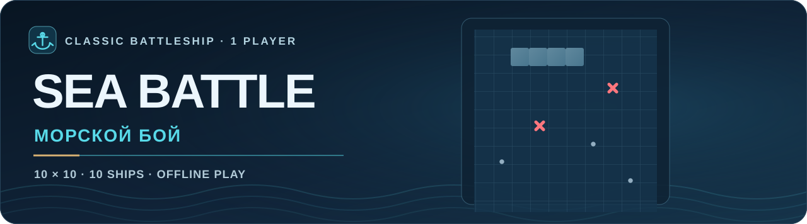

<p align="center">
  
</p>

<p align="center">
  <a href="README.md"><strong>🇺🇸 English</strong></a> &nbsp;·&nbsp; <a href="README.ru.md">🇷🇺 Русский</a>
</p>

<p align="center">
  <a href="https://stanleyll0yd.github.io/SeaBattle/"><strong>▶ PLAY IN BROWSER</strong></a> &nbsp;·&nbsp; <a href="https://github.com/StanleyLl0yd/SeaBattle/actions/workflows/ci.yml">CI status</a> &nbsp;·&nbsp; <a href="CHANGELOG.md">Changelog</a>
</p>

---

Ahoy, Captain! **⚓ Sea Battle** is a classic single-player Battleship game against the computer. Two fleets, a 10 × 10 sea grid, and one mission: send the enemy fleet to the bottom before yours follows it. The computer has put on its sternest captain's face — don't be intimidated. Play in your browser — no account or installation required.

## ⚓ 01 · Fleet & rules

| Ship length | Number of ships | Occupied cells |
| :---: | :---: | :---: |
| 4 | 1 | 4 |
| 3 | 2 | 6 |
| 2 | 3 | 6 |
| 1 | 4 | 4 |
| **Total** | **10** | **20** |

- Each player has a **10 × 10** grid. Ships are placed horizontally or vertically and **must not touch**, even diagonally. No friendly rafting up — not even corner-to-corner.
- **You fire first.** A hit or a sunk ship gives you another shot; a miss passes the turn. Missed the target? Hand the helm to the computer.
- When a ship is sunk, its surrounding empty cells are marked automatically.
- The first player to sink all ten opposing ships wins. No medals for second place in this fleet.

## 🎯 02 · Take command

1. Open the [game](https://stanleyll0yd.github.io/SeaBattle/) in your browser.
2. Your ships are already on station. Keep the automatically arranged fleet, select **Random fleet** to shuffle it, or choose **Place manually** if your inner admiral insists.
3. For manual placement, select a starting cell; use **Rotate (R)** or the physical **R-position key** (works with any keyboard layout) to change orientation. **Undo** removes the last ship.
4. Select **Start battle**, take aim, then fire by selecting cells on the computer's grid. Periscope optional.
5. After a victory or defeat, use the prominent **New battle** button beneath the result to play again (the header's **New game** button also remains available). Even seasoned sea dogs deserve a rematch. The layout supports desktop, mobile, and keyboard navigation.

**⚓ Naval campaign (new in 0.4.0).** Start as a **Seaman** and earn promotions across **19 Russian Navy shipboard ranks**, reaching **Admiral of the Fleet after 45 campaign wins**. The opponent has six actual AI tiers that grow stronger as you advance. Defeats do not take away earned victories or demote you. The top rank stays playable indefinitely.

**🇺🇸 US Navy campaign (new in 0.5.0).** Choose **Russian Navy** or **US Navy** independently of the EN/RU interface language. Both main careers have **19 stages, 45 wins and identical six AI tiers**, but their rank titles are authentic to each navy. The US ladder runs from **Seaman Recruit (E-1)** through **Admiral (O-10)**. The existing Russian career is migrated intact from the previous save; each navy has its own victories, defeats, streaks and honors.

**Specialist route.** After **Chief Petty Officer (E-7)**, five optional Warrant Officer trial grades (W-1–W-5) can be earned with **2, 4, 7, 10 and 14** specialist victories respectively. These do **not** advance the main campaign. After **Admiral**, win **three consecutive battles at maximum difficulty** to earn the historical five-star **Fleet Admiral** distinction. It is an award, **not** a 20th active rank; a loss restarts only the three-win streak.

**⚓ Fairer difficulty (0.6.0).** AI search now ramps up between the rank bands instead of abruptly unlocking full-fleet sampling at level 9. Early ranks use progressively better placement search; advanced ranks blend whole-fleet sampling with a fast baseline and respond to observed edge-heavy defenses. Sampling is time-bounded and does not inspect hidden player ships. Different ranks are not mathematically guaranteed to improve on every possible fleet; unusual placements can still give a clever captain an advantage.

**⚓ More reasons to return (1.2.0).** Daily Challenge now records the **first started attempt** as the official local result; abandoning it does not reset that attempt. Later runs are practice and may still improve the separate personal best. A **three-battle series** uses one chosen AI level and ranks the best series by victories, then total shots. Personal statistics compare the last ten and previous ten completed matches, active days in the last week and the best winning score in the last 30 days. Only bounded summaries, never ships or shot traces, are saved. Instant rematches keep your fleet and generate a fresh enemy; optional fast computer turns reduce waiting. Ordinary opponents use four legal fleet-layout strategies.

**⚓ Smoother difficulty (1.2.0).** All 19 ranks have continuously adjusted sampling, exploration, edge adaptation and diagonal covering probabilities. The final ranks remain strictly limited to public shot evidence and bounded computation; balance is checked against the 1.1.0 AI on matched defensive fleets.

**⚓ Stronger fair AI (1.1.0).** At higher ranks (13–19), when finishing exposed hits among the last two remaining ships, the opponent builds bounded samples of *complete* non-touching surviving fleets that cover **every** revealed hit and avoid all observed misses. Near the end of a game it enumerates legal full-fleet configurations where practical; targeted follow-up shots account for damaged ships and the extra turn earned by a hit. Sampling is approximate and time-limited, never reads hidden ship positions, and falls back safely if evidence is too restrictive. At ranks 17–19 the ordinary hunt also prioritizes a diagonal covering pattern based on the shortest surviving multi-cell ship. Ranks 1–12 retain their established behavior.

**Quick battle** unlocks any of the 19 difficulty settings right away, without affecting campaign progress. Campaign victories, defeats, streaks and honors are saved on this device using browser `localStorage`; your unfinished battle is not saved. You can reset the career with a confirmation. The first-hit, three-win-streak and accurate-victory honors are optional little naval decorations — no in-app purchases, accounts or leaderboards.

<details><summary>🇺🇸 US Navy: all 19 main ranks and their unlocks</summary>

| Level | US Navy rank | Total campaign wins |
| :---: | :--- | ---: |
| 1 | Seaman Recruit (E-1) | 0 |
| 2 | Seaman Apprentice (E-2) | 1 |
| 3 | Seaman (E-3) | 2 |
| 4 | Petty Officer Third Class (E-4) | 3 |
| 5 | Petty Officer Second Class (E-5) | 5 |
| 6 | Petty Officer First Class (E-6) | 7 |
| 7 | Chief Petty Officer (E-7) | 9 |
| 8 | Senior Chief Petty Officer (E-8) | 11 |
| 9 | Master Chief Petty Officer (E-9) | 13 |
| 10 | Ensign (O-1) | 15 |
| 11 | Lieutenant Junior Grade (O-2) | 17 |
| 12 | Lieutenant (O-3) | 20 |
| 13 | Lieutenant Commander (O-4) | 23 |
| 14 | Commander (O-5) | 26 |
| 15 | Captain (O-6) | 29 |
| 16 | Rear Admiral (Lower Half) (O-7) | 32 |
| 17 | Rear Admiral (Upper Half) (O-8) | 36 |
| 18 | Vice Admiral (O-9) | 40 |
| 19 | Admiral (O-10) | 45 |

</details>

<details><summary>⚓ All 19 ranks and promotion milestones</summary>

| Level | Naval rank | Total campaign wins to unlock |
| :---: | :--- | ---: |
| 1 | Seaman | 0 |
| 2 | Senior Seaman | 1 |
| 3 | Petty Officer 2nd Class | 2 |
| 4 | Petty Officer 1st Class | 3 |
| 5 | Chief Petty Officer | 5 |
| 6 | Chief Shipboard Petty Officer | 7 |
| 7 | Warrant Officer | 9 |
| 8 | Senior Warrant Officer | 11 |
| 9 | Junior Lieutenant | 13 |
| 10 | Lieutenant | 15 |
| 11 | Senior Lieutenant | 17 |
| 12 | Captain-Lieutenant | 20 |
| 13 | Captain 3rd Rank | 23 |
| 14 | Captain 2nd Rank | 26 |
| 15 | Captain 1st Rank | 29 |
| 16 | Rear Admiral | 32 |
| 17 | Vice Admiral | 36 |
| 18 | Admiral | 40 |
| 19 | Admiral of the Fleet | 45 |

</details>

### ⚓ Daily sea challenge and tactical review (0.7.1)

Choose **Daily challenge** in the mode selector. Every UTC calendar date has one reproducibly generated opponent fleet shared by all players running the same game release. In this solo puzzle you shoot until all ships are sunk; the computer never takes a turn. Minimize your **total shots** (hits and misses). The browser saves your first-attempt score from 1.2.0 onward alongside the separate best result, never hidden fleet cells or shot coordinates. After completion, **Copy result** includes the date and shot count plus whether the run was official or practice, without revealing the fleet.

Every finished battle also includes a **tactical review** showing how many shots were fired while searching versus finishing a damaged ship, plus counts of high-scored choices and potentially more promising alternatives. These are **approximate, public-information-only assessments**, not retrospective proof of the best possible move. A damaged ship's possible continuations respect the remaining ship sizes, visible hits, and the no-touch rule; concrete alternatives appear on a separate line.

The expandable **Recent 7 UTC days** history lists each day's personal best or unplayed status. It reads only existing local aggregate scores; no coordinates or tracking are added.

**Tactical trainer (0.9.0).** During an active **Quick battle**, select **Show tactical hint** to see up to three unshot cells ranked by a relative legal-placement score and compare your previous shot with an alternative assessed *before* you fired. The score is **not a hit probability** or a promise of success. The trainer is hidden in campaigns and daily challenges, disabled by default every battle, uses only public shots and remaining ship lengths, and stores nothing.

**Personal statistics (0.9.1).** Open the collapsible **Personal statistics** panel to see completed games, wins, losses, shooting accuracy (hits / shots) and fewest shots for a victory, with separate mode summaries for the Russian and US Navy campaigns, Quick Battle, Daily, Warrant Officer trials and Fleet Admiral challenge. Counting begins only with battles completed after updating to v0.9.1; earlier matches are not estimated from existing careers or daily scores. Records contain only aggregate numbers on this device — no layouts, shot histories, accounts, cloud sync or telemetry. Clearing site data or uninstalling the PWA may erase these numbers.

**Manual backup / restore (0.9.2).** In the Personal statistics panel, expand **Local backup / restore**, choose **Show backup text**, and copy the JSON to a safe place. To restore on this or another device, paste the saved text and confirm **Restore from text**. The backup carries validated aggregate RU/US career progress, chosen navy, recent Daily best scores and v0.9.1+ statistics; it never includes fleets, live games or shot traces. Restoring **replaces** the current local records, so keep a copy first. This works offline, without an account or server. Restoration is disabled during an active battle; if browser storage is blocked, check progress before retrying.

### 📱 Install and play offline

SeaBattle is now a small **progressive web app**: open the hosted game once while connected, then use your browser's **Install app / Add to Home Screen** command (where supported). Its local service worker caches the complete game shell and 192/512-pixel icons under the GitHub Pages project path. Wait for the **Ready for offline play** message before disconnecting; it appears once the service worker is active after the game shell has been cached. On macOS Safari, installed web apps have separate site data from Safari tabs: open the **installed app itself** with internet at least once, wait for readiness, then fully quit and cold-launch offline. After that, the game can launch without a connection. Updates are downloaded when a new service worker installs; your in-progress match is not automatically reloaded. Clearing site data or uninstalling can erase local progress; this is not cloud synchronization.

## 🌐 03 · Language & accessibility

- **English is the default language.** If the browser's primary language is Russian (`ru`, `ru-RU`, `ru_*`), the game starts in Russian; all other locales use English.
- The **EN/RU** selector changes language instantly, even during a battle, without resetting the match. New orders, same battle.
- Board coordinates, instructions, notifications, buttons, document title, and screen-reader labels all follow the selected language.
- Language selection is limited to the current page; a reload detects the browser language again. It does not send data over the network.
- These repository instructions are also available [in Russian](README.ru.md).

## 🛠 04 · Run & develop

No need to launch an entire shipyard: this is a lightweight **browser-based** HTML/CSS/JavaScript game with **zero runtime dependencies** and currently no build step. Its HTML, CSS, game rules and AI are presently housed in `index.html`, but a single-file distribution is **not** a project requirement. Separate modules/assets when there is a demonstrable maintenance, testing or performance benefit. The computer now uses a **bounded, approximate fleet-probability search**: it samples whole legal fleets consistent with revealed shots, adapts to patterns seen during the match, finishes damaged ships first, and falls back to a fast placement heatmap when needed. No peeking at hidden ship positions — even admirals must play fair.

The browser tab now uses the ship-and-hit **SeaBattle icon** (`assets/seabattle-icon.svg`) with a compact ICO fallback (`favicon.ico`). The icon is intentionally simple enough to remain recognizable at 16×16; other design studies and PNG exports are archived separately and are not loaded by the game.

Automated tests require **Node.js 22+**:

```sh
npm test
```

GitHub Actions verifies engine and localization tests on pull requests. The protected `main` branch automatically publishes to GitHub Pages **only after successful tests**. Read [AGENTS.md](AGENTS.md) for mandatory audit/refactoring, artwork, and repository standards.

## 🚢 05 · Release & project links

| | |
| :-- | :-- |
| **Current version** | `1.2.0` |
| **Play online** | [SeaBattle on GitHub Pages](https://stanleyll0yd.github.io/SeaBattle/) |
| **Source code** | [StanleyLl0yd/SeaBattle](https://github.com/StanleyLl0yd/SeaBattle) |
| **Release history** | [CHANGELOG.md](CHANGELOG.md) |
| **CI** | [GitHub Actions](https://github.com/StanleyLl0yd/SeaBattle/actions/workflows/ci.yml) |
| **License** | No reuse license has been granted yet. |

---

<p align="center">
  <a href="README.md"><strong>🇺🇸 English</strong></a> &nbsp;·&nbsp; <a href="README.ru.md">🇷🇺 Русский</a>
</p>

<p align="center"><sub>⚓ SEA BATTLE · 10 × 10 · FAIR WINDS & ACCURATE SALVOS</sub></p>
