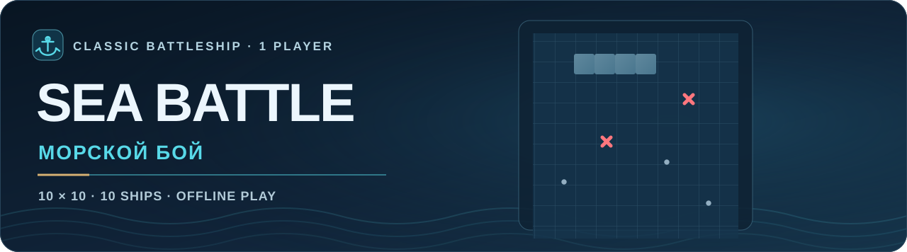

<p align="center">
  
</p>

<p align="center">
  <a href="README.md">🇺🇸 English</a> &nbsp;·&nbsp; <a href="README.ru.md"><strong>🇷🇺 Русский</strong></a>
</p>

<p align="center">
  <a href="https://stanleyll0yd.github.io/SeaBattle/"><strong>▶ ИГРАТЬ В БРАУЗЕРЕ</strong></a> &nbsp;·&nbsp; <a href="https://github.com/StanleyLl0yd/SeaBattle/actions/workflows/ci.yml">Статус CI</a> &nbsp;·&nbsp; <a href="CHANGELOG.md">История изменений</a>
</p>

---

Свистать всех наверх! **⚓ Морской бой** — классическая одиночная игра против компьютера. Два флота, морское поле 10 × 10 и боевой приказ: отправить чужие корабли на дно раньше, чем свои. Компьютер уже сделал грозное капитанское лицо — но нас этим не напугаешь. Играй прямо в браузере — без регистрации и установки.

## ⚓ 01 · Флот и правила

| Длина корабля | Количество | Палуб |
| :---: | :---: | :---: |
| 4 | 1 | 4 |
| 3 | 2 | 6 |
| 2 | 3 | 6 |
| 1 | 4 | 4 |
| **Всего** | **10** | **20** |

- У каждого игрока поле **10 × 10**. Корабли ставятся горизонтально или вертикально и **не могут касаться** друг друга даже углами. Никаких дружеских швартовок — даже уголком к уголку.
- **Ты стреляешь первым.** При попадании или потоплении ход продолжается, при промахе переходит сопернику. Промазал? Штурвал временно у компьютера.
- Когда корабль потоплен, соседние пустые клетки автоматически отмечаются.
- Побеждает тот, кто первым потопит все десять кораблей противника. За второе место флотских медалей не выдают.

## 🎯 02 · Управление

1. Открой [игру](https://stanleyll0yd.github.io/SeaBattle/) в браузере.
2. Корабли уже на боевых позициях. Оставь готовую расстановку, нажми **«Авторасстановка»** для новой или выбери **«Вручную»**, если внутренний адмирал требует порядка.
3. При ручной расстановке выбери начальную клетку, используй **«Повернуть (R)»** или физическую клавишу **на месте английской R** (в любой раскладке) для поворота. **«Отменить»** удаляет последний корабль.
4. Нажми **«Начать бой»**, бери противника на прицел и стреляй, выбирая клетки на поле компьютера. Перископ необязателен.
5. Нажми **«Новая партия»**, чтобы начать заново: даже бывалому морскому волку положен реванш. Игра подходит для компьютера, смартфона и управления клавиатурой.

**⚓ Морская кампания (новинка 0.4.0).** Начни **матросом**, получи все **19 корабельных званий ВМФ России** и дослужись до **адмирала флота за 45 побед в кампании**. Компьютер использует шесть ступеней ИИ, которые становятся сильнее по мере повышения. Поражения не отнимают уже заработанные победы и звания. На последнем уровне можно играть сколько угодно.

**Быстрый бой** позволяет сразу выбрать любую из 19 сложностей, но такие победы не засчитываются в карьеру. Победы, поражения, серии и награды хранятся на этом устройстве в `localStorage` браузера; незаконченная партия не сохраняется. Карьеру можно сбросить с подтверждением. За первое попадание, три победы подряд и меткую победу выдаются небольшие награды — без регистрации, покупок и таблиц лидеров.

<details><summary>⚓ Все 19 званий и пороги повышения</summary>

| Уровень | Корабельное звание | Всего побед для открытия |
| :---: | :--- | ---: |
| 1 | Матрос | 0 |
| 2 | Старший матрос | 1 |
| 3 | Старшина 2-й статьи | 2 |
| 4 | Старшина 1-й статьи | 3 |
| 5 | Главный старшина | 5 |
| 6 | Главный корабельный старшина | 7 |
| 7 | Мичман | 9 |
| 8 | Старший мичман | 11 |
| 9 | Младший лейтенант | 13 |
| 10 | Лейтенант | 15 |
| 11 | Старший лейтенант | 17 |
| 12 | Капитан-лейтенант | 20 |
| 13 | Капитан 3-го ранга | 23 |
| 14 | Капитан 2-го ранга | 26 |
| 15 | Капитан 1-го ранга | 29 |
| 16 | Контр-адмирал | 32 |
| 17 | Вице-адмирал | 36 |
| 18 | Адмирал | 40 |
| 19 | Адмирал флота | 45 |

</details>

## 🌐 03 · Язык и доступность

- **Английский — язык по умолчанию.** При русской основной локали браузера (`ru`, `ru-RU`, `ru_*`) игра автоматически переключается на русский; для остальных локалей выбирается английский.
- Переключатель **EN/RU** мгновенно меняет язык даже посреди боя, не сбрасывая партию. Приказы новые, бой прежний.
- Координаты поля, инструкции, сообщения, кнопки, заголовок страницы и подписи для скринридеров переводятся вместе с интерфейсом.
- Выбранный язык действует до перезагрузки страницы, затем снова определяется по браузеру. Никаких сетевых запросов для этого нет.
- Английская версия документации находится [в README.md](README.md).

## 🛠 04 · Запуск и разработка

Разворачивать целую верфь не придётся: это лёгкая **браузерная игра** на HTML/CSS/JavaScript, **без внешних зависимостей во время работы** и пока без сборки. Сейчас интерфейс, стили, правила и ИИ находятся в `index.html`, но **единый HTML-файл больше не обязателен**: модули и ресурсы можно разделять при доказанной пользе для разработки, тестов или производительности. Теперь компьютер использует **ограниченный по времени вероятностный поиск**: моделирует целые допустимые флоты с учётом открытых выстрелов, подстраивается под замеченные закономерности, сначала добивает повреждённые корабли и при необходимости переходит на быструю карту вероятностей. В чужие скрытые координаты не подглядывает — даже адмиралу положено играть честно.

Для запуска автоматических тестов нужен **Node.js 22+**:

```sh
npm test
```

GitHub Actions проверяет игровые правила и локализацию в pull request. Защищённая ветка `main` автоматически публикуется на GitHub Pages **только после успешных тестов**. Обязательные правила аудита/рефакторинга, работы с графикой и репозиторием описаны в [AGENTS.md](AGENTS.md).

## 🚢 05 · Версия и ссылки

| | |
| :-- | :-- |
| **Текущая версия** | `0.4.0` |
| **Играть онлайн** | [SeaBattle на GitHub Pages](https://stanleyll0yd.github.io/SeaBattle/) |
| **Исходный код** | [StanleyLl0yd/SeaBattle](https://github.com/StanleyLl0yd/SeaBattle) |
| **История изменений** | [CHANGELOG.md](CHANGELOG.md) |
| **CI** | [GitHub Actions](https://github.com/StanleyLl0yd/SeaBattle/actions/workflows/ci.yml) |
| **Лицензия** | Лицензия на повторное использование пока не предоставлена. |

---

<p align="center">
  <a href="README.md">🇺🇸 English</a> &nbsp;·&nbsp; <a href="README.ru.md"><strong>🇷🇺 Русский</strong></a>
</p>

<p align="center"><sub>⚓ МОРСКОЙ БОЙ · 10 × 10 · СЕМИ ФУТОВ ПОД КИЛЕМ И МЕТКИХ ЗАЛПОВ</sub></p>
